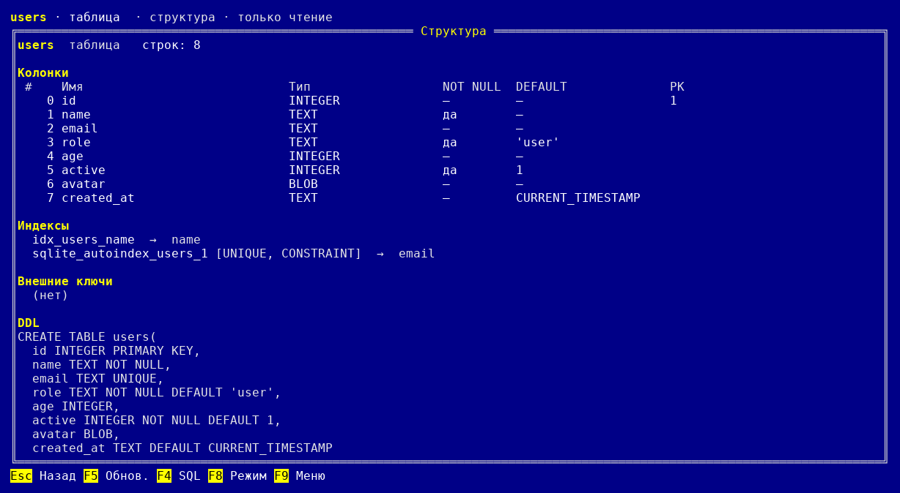
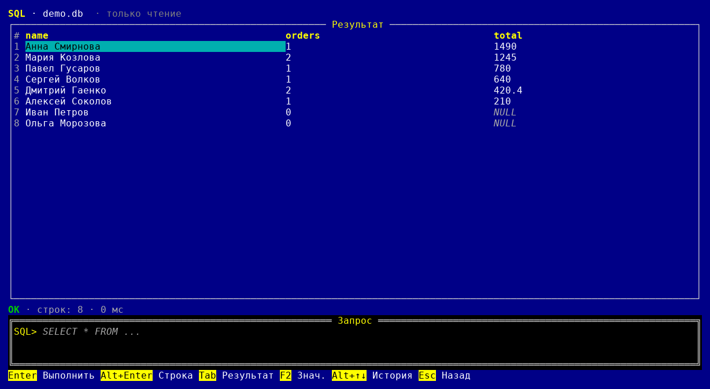
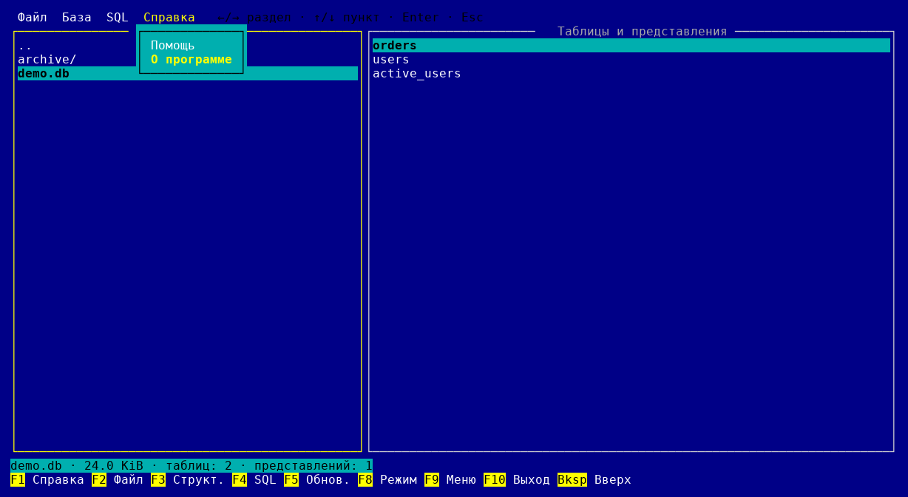
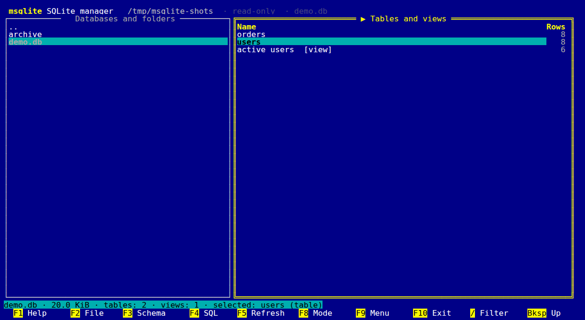
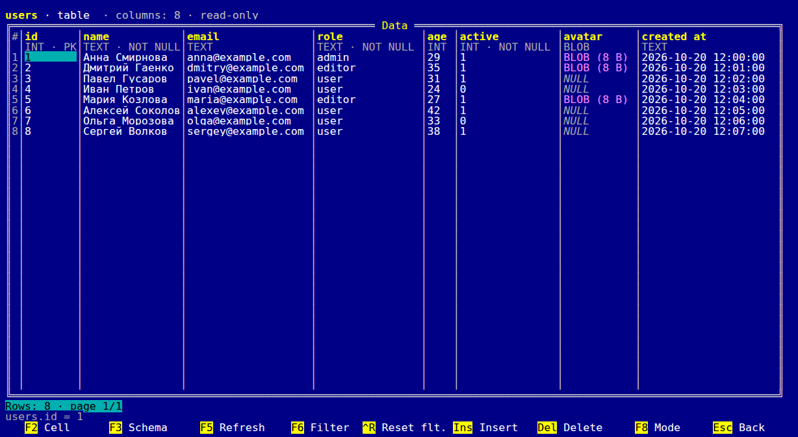
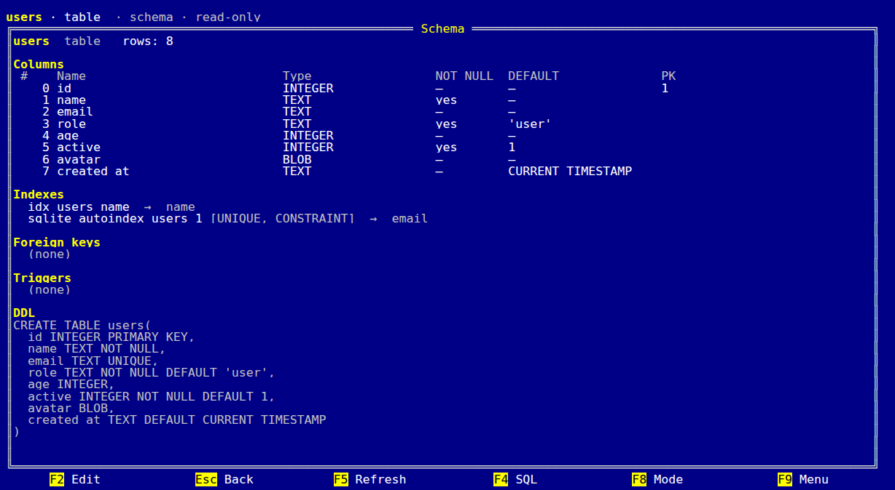
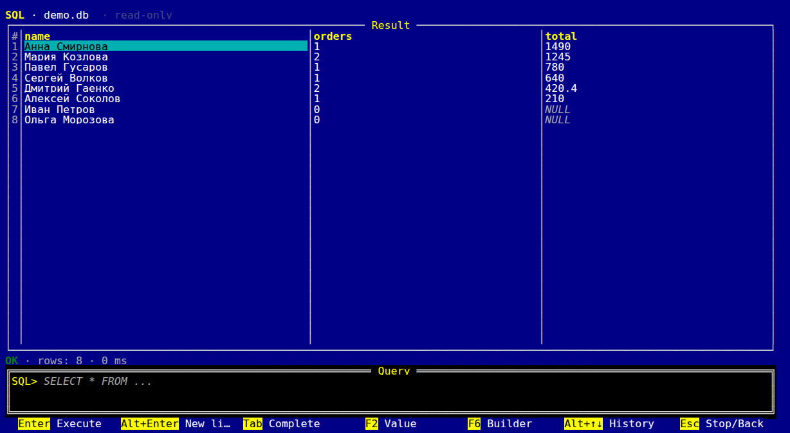
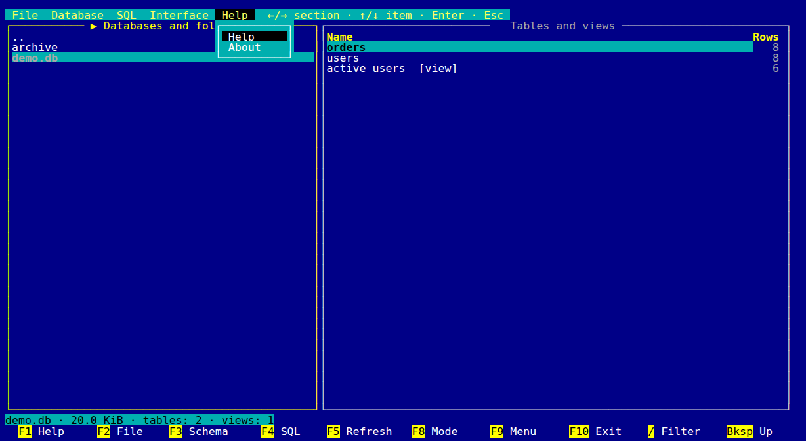
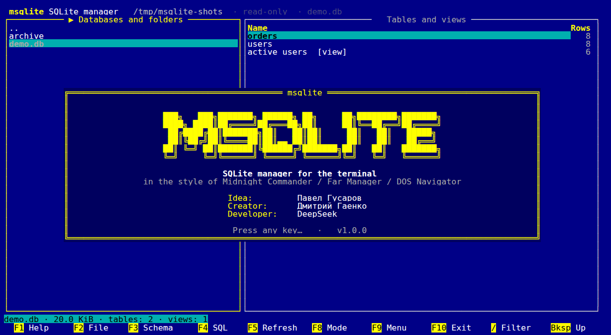

# msqlite

[Русский](#msqlite) | [English](#msqlite-english)

TUI-менеджер SQLite в стиле Midnight Commander / Far Manager. Позволяет
просматривать базы, таблицы, представления, структуру и данные, редактировать
записи и выполнять SQL-запросы прямо в терминале.

Работает на Linux, в том числе на Raspberry Pi 4B (Ubuntu / Raspberry Pi OS).
Бинарники статические, без внешних зависимостей.

## Возможности

- Файловый браузер: папки и SQLite-файлы в текущем каталоге, вход в подпапки,
  подъём через `..` или `Backspace` вплоть до `/`.
- Открытие базы аргументом (`msqlite file.db`) и список недавних баз.
- Список таблиц и представлений выбранной базы с числом строк (оценка `~N` из
  `sqlite_stat1`, для таблиц без статистики — точный `COUNT(*)`) и фильтром по
  имени (`/`).
- Структура объекта: колонки, типы, `NOT NULL`, значения по умолчанию,
  первичные ключи, индексы, внешние ключи, триггеры и DDL; generated-колонки
  помечаются и доступны только для чтения.
- Просмотр данных с постраничной навигацией, сортировкой, SQL-фильтром
  и отключаемыми вертикальными разделителями колонок.
- Автообновление открытой базы при изменении файла извне: список таблиц,
  данные и структура перечитываются с сохранением курсора и страницы.
- Редактирование ячеек, вставка и удаление строк (для обычных rowid-таблиц).
- Многострочная SQL-консоль с сохраняемой историей запросов, автодополнением
  (`Tab`/`Ctrl+Space`), подсветкой синтаксиса, конструктором запросов (`F6`),
  табличным результатом и отменой долгого запроса по `Esc`.
- Верхнее меню действий (`F9`) и быстрая палитра (`Ctrl+P`).
- Три темы интерфейса: Midnight Commander, DOS Navigator (серая) и
  DOS Navigator Blue (синяя, как в классическом DN II, с диалогами в стиле
  DN II); переключение в разделе «Интерфейс».
- Русская и английская локализация интерфейса; язык переключается в разделе
  «Интерфейс» и запоминается. Если язык ещё не выбран, он определяется по
  системной локали (`ru*` — русский, иначе английский).
- Экспорт таблицы, текущей страницы, выбранной строки или результата SQL
  в CSV/JSON;
  импорт CSV и JSON, экспорт SQL-дампа.
- Резервное копирование базы, `VACUUM`, `ANALYZE`, проверка целостности.
- Копирование ячеек и строк в буфер обмена, дублирование строк.
- Просмотр BLOB в hex и сохранение BLOB в файл.
- Создание таблиц визуальным конструктором (колонки: тип, `PK`,
  `NOT NULL`, `DEFAULT`) и представлений; создание/удаление индексов,
  очистка и удаление таблиц.
- Режим «только чтение» по умолчанию; переключение на запись через `F8`.
- Определение баз по заголовку SQLite, а не по расширению файла.
- Сплеш-экран с авторами при запуске (закрывается через 3 секунды или любой
  клавишей; отключается флагом `-no-splash` или в разделе «Интерфейс»).
- Мышь: выбор панели, строки, ячейки и кнопок в диалогах; в меню `F9`
  кликабельны разделы верхней строки и пункты подменю.

## Скриншоты

### Главный экран и данные

<p align="center">
  
  
</p>

### Структура и SQL-консоль

<p align="center">
  
  
</p>

### Верхнее меню и сплеш

<p align="center">
  
  
</p>

## Требования

- Linux (amd64, arm64 или armv7).
- Для сборки: Go 1.22.2+ и `make`.
- Терминал с UTF-8 (для рамок и кириллицы). Рекомендуется минимум 80x24.

## Сборка

```bash
make build       # amd64 + arm64 (+ публикация, если настроена)
make build-amd64 # только локальный бинарник: bin/msqlite
make pi          # Raspberry Pi / Ubuntu arm64: bin/msqlite-linux-arm64
make pi32        # 32-битный ARMv7: bin/msqlite-linux-armv7
make dist        # все три сборки (+ публикация, если настроена)
```

`make build`, `make publish` и `make dist` после сборки обновляют пакет
обновления, если в рабочей копии настроен скрипт публикации; иначе они просто
собирают бинарники. В пакет входят только amd64 и arm64; armv7 собирается,
но не публикуется.

Сборка выполняется с `CGO_ENABLED=0`, бинарники статические.

## Версионирование

Версия вычисляется автоматически при сборке и внедряется в бинарник
в формате semver 2.0.0:

- Точный Git-тег `vX.Y.Z` даёт `X.Y.Z`; коммиты после тега и незакоммиченные
  изменения добавляются как build-metadata: `X.Y.Z+git.N.gHASH`,
  `X.Y.Z+HASH.dirty` — строка всегда остаётся валидным semver.
- Без тегов используется базовая версия из `VERSION`:
  `X.Y.Z+git.N.gHASH`; незакоммиченные изменения добавляют `.dirty`.
- Без Git берётся `VERSION` и добавляется `+build.<hash>` — хэш всех `.go`,
  `go.mod` и `go.sum`. Любое изменение исходников меняет версию.
- Принудительно задать версию: `MSQLITE_VERSION=1.2.3 make build-amd64`
  (значение проверяется на соответствие semver).

```bash
make version              # показать вычисленную версию
./bin/msqlite -version    # версия, commit, дата сборки, версия Go
```

Базовая версия хранится в `VERSION`; меняйте её для релиза. Для Git-релиза
используйте тег `vX.Y.Z`. Версия отображается в сплеше, справке и `-version`.
Собирайте релизы через `make`, а не напрямую через `go build`, иначе версия
останется `1.0.0-dev`.

## Установка

```bash
sudo ./install.sh
```

Установщик определяет архитектуру, при необходимости пересобирает бинарник
(если исходники новее), копирует его в `$PREFIX/bin` (по умолчанию
`/usr/local/bin`), создаёт симлинк `msqlite` и проверяет результат: совпадение
файла, симлинк, SHA256 и версию для нативной архитектуры.

```text
/usr/local/bin/msqlite-linux-arm64
/usr/local/bin/msqlite -> msqlite-linux-arm64
```

Опции:

```bash
sudo ./install.sh --prefix /opt/msqlite
./install.sh --dest "$HOME/bin"
./install.sh --dest ./bin --arch arm64
./install.sh --no-build              # ставить готовый бинарник без пересборки
sudo ./install.sh --uninstall
```

Также доступны `make install` и `make uninstall`.

## Запуск

```bash
msqlite                 # последний каталог (при первом запуске — текущий)
msqlite file.db         # сразу открыть базу
msqlite /data/db        # сразу открыть каталог
msqlite -dir /data/db   # указать каталог
msqlite -rw             # сразу с правами записи
msqlite -page 50        # размер страницы данных (по умолчанию 100)
msqlite -no-splash      # не показывать сплэш при запуске
msqlite -version
```

При старте показываются папки и SQLite-файлы выбранного каталога.
Режим отображается в шапке.

## Клавиши

### Главный экран

| Клавиша | Действие |
|---|---|
| `Tab` / `Shift+Tab` | переключение панелей |
| `/` | фильтр списка таблиц по имени (пусто — сбросить) |
| `Enter` | открыть базу/таблицу, войти в папку или `..` |
| `Backspace` | подняться на каталог выше (до `/`) |
| `F1` | справка |
| `F2` | открыть файл или каталог по пути |
| `F3` | структура выбранной таблицы |
| `F4` | SQL-консоль |
| `F5` | обновить каталог, данные и оценки счётчиков |
| `F8` | переключить режим чтение / запись |
| `F9` | верхнее меню: Файл, База, Данные, SQL, Интерфейс, Справка |
| `Ctrl+P` | быстрая палитра действий |
| `F10`, `Alt+X` | выход (с подтверждением) |
| `Esc` | выход с подтверждением (на подэкранах — назад) |

### Просмотр данных

| Клавиша | Действие |
|---|---|
| стрелки | перемещение по ячейкам |
| `Enter`, `F2` | редактировать ячейку / показать значение |
| `Ctrl+S` | сохранить ячейку |
| `Ins` | вставить строку |
| `Del` | удалить строку (с подтверждением) |
| `F6` | фильтр: конструктор `WHERE` (колонка, оператор, значение) или ручной ввод; пусто сбрасывает фильтр |
| `Ctrl+R` | сбросить фильтр |
| `F7` / `PgUp` | предыдущая страница |
| `PgDn` | следующая страница |
| `Home` / `End` | первая / последняя страница |
| `s` / клик по заголовку | сортировка колонки: ASC → DESC → без сортировки |
| `F3` | структура таблицы |
| `F5` | перечитать данные |
| `Esc` | назад |

Редактор ячейки подстраивает размер под тип: числовые поля открываются в
компактном окне (сохранение по `Enter`), строковые — в большом, BLOB и прочие
типы — в максимальном (сохранение по `Ctrl+S`, `Tab` переключает на кнопки).
Для текстовых ячеек доступны кнопки генерации хешей: `MD5`, `SHA-1`, `SHA-256`,
`SHA-512` и `bcrypt`.

### Структура таблицы

| Клавиша | Действие |
|---|---|
| `F2` | редактировать структуру |
| `F5` | обновить |
| `F4` | SQL-консоль |
| `Esc` | назад |

В редакторе структуры (`F2`): переименование таблицы, добавление, переименование
и удаление колонок. Изменение типа/ограничений существующих колонок, индексы и
внешние ключи — через SQL-консоль.

### SQL-консоль

| Клавиша | Действие |
|---|---|
| `Enter` | выполнить запрос |
| `Alt+Enter` | новая строка в запросе |
| `Tab` | автодополнение слова; повтор — следующий вариант. Если дополнять нечего — фокус на результат |
| `Ctrl+Space` | то же автодополнение SQL-команд, таблиц и полей |
| `F6` | конструктор SELECT: таблица, колонки, `WHERE`, `ORDER BY`, `LIMIT` |
| `F2` | полное значение выбранной ячейки |
| `Alt+↑` / `Alt+↓` | история запросов (сохраняется между запусками) |
| `F8` | переключить режим чтение / запись |
| `F9` | верхнее меню действий |
| `Esc` | отменить выполняющийся запрос, иначе назад |

Выполняется одна инструкция за раз. Для `SELECT` выводится не более 1000
строк. В режиме только чтения изменяющие запросы завершаются ошибкой SQLite.

### Действия `F9` / `Ctrl+P`

`F9` открывает верхнее меню с подменю. Переключение разделов — `←`/`→`
(или `Tab`), выбор пункта — `↑`/`↓`, выполнение — `Enter`, закрытие — `Esc`.
Разделы: **Файл**, **База**, **Данные**, **SQL**, **Интерфейс**, **Справка**.
`Ctrl+P` открывает те же действия плоским списком.

- Открытие недавних баз (список хранится в конфигурации пользователя)
  и создание новой базы данных.
- «Интерфейс» — выбор темы Midnight Commander, DOS Navigator или
  DOS Navigator Blue, языка (Русский / English) и размера страницы данных.
  Текущий выбор отмечен галочкой.
- «О программе» в разделе «Справка» — повторный показ сплеша.
- Экспорт текущей таблицы (все строки), страницы, выбранной строки или
  результата SQL в CSV/JSON.
- Импорт CSV (заголовок распознаётся автоматически) и JSON (массив объектов)
  в текущую таблицу.
- Точный пересчёт счётчиков строк (в списке показываются оценки `~N` из
  `sqlite_stat1` после `ANALYZE`; для таблиц без статистики число строк
  считается запросом `COUNT(*)`).
- Сброс активного фильтра таблицы.
- Конструктор `WHERE` для фильтра: выбор колонки, оператора и значения с ручной правкой выражения.
- Экспорт SQL-дампа базы, резервная копия через `VACUUM INTO`.
- `VACUUM`, `ANALYZE`, `PRAGMA integrity_check`.
- Дублирование строки, копирование ячейки/строки в буфер обмена.
- Просмотр BLOB в hex, сохранение BLOB в файл.
- Создание таблиц визуальным конструктором и представлений; создание и
  удаление индексов, очистка и удаление таблицы.
- Экспорт результата SQL-запроса (до 1000 показанных строк) в CSV/JSON.

### Диалоги

Во всех диалогах есть кнопки `OK` и `Отмена`.
`Enter` или `Space` активируют выбранную кнопку, `Tab` / стрелки переключают
кнопки, `Esc` закрывает диалог. Активная кнопка подсвечена жёлтым.
Результаты SQL-запроса показывают вертикальные разделители колонок;
они отключаются в `F9` → «Интерфейс» → «Разделители колонок».

### Настройки

Настройки интерфейса сохраняются автоматически в
`~/.config/msqlite/config.json`:

- тема (`mc`/`dos`/`dos-blue`);
- язык интерфейса (`ru`/`en`); если не выбран, определяется по системной
  локали: `ru*` — русский, иначе английский;
- размер страницы данных;
- вертикальные разделители колонок таблицы;
- режим по умолчанию (только чтение / чтение-запись);
- запоминание последнего открытого каталога (можно отключить);
- показ сплэша при запуске;
- история SQL-запросов (до 200).

Тема, язык, размер страницы, разделители колонок и запоминание последней папки
меняются в `F9` → «Интерфейс», режим — клавишей `F8`.
Флаги `-rw` и `-page` имеют приоритет над сохранёнными значениями при запуске.
Последний каталог восстанавливается, если не заданы `-dir` или путь в аргументе,
и включено запоминание последней папки.
Старый файл `~/.config/msqlite/theme` учитывается, пока не создан общий
`config.json`.

### Форма вставки

| Клавиша | Действие |
|---|---|
| `Tab` / `↑` / `↓` | переход между полями |
| `PgUp` / `PgDn` | прокрутка полей |
| `Enter` | следующее поле / вставка на последнем |
| `Ctrl+S` | вставить строку |
| `Esc` | отмена |

Пустое поле не передаётся в `INSERT` (используется значение по умолчанию).
Значение `NULL` вставляет SQL `NULL`, `''` — пустую строку, `x'ABCD'` — BLOB.

## Режимы чтения и записи

- По умолчанию база открывается только для чтения.
- `F8` переключает режим на лету: текущая база переоткрывается, режим
  обновляется во всех экранах. Для новых баз режим сохраняется.
- Флаг `-rw` включает режим записи при старте.
- В режиме записи включена проверка внешних ключей SQLite (`foreign_keys=ON`).
- Если файл или каталог недоступны для записи, переключение завершится ошибкой.

## Ограничения

- Инлайн-редактирование доступно только для обычных таблиц с `rowid`.
  Представления (`VIEW`), таблицы `WITHOUT ROWID` и виртуальные таблицы
  доступны только для чтения; для них используйте SQL-консоль.
- BLOB-ячейки в табличном просмотре не редактируются (показываются как
  `BLOB (N B)`).
- SQL-консоль выполняет одну инструкцию; результаты `SELECT` ограничены
  1000 строками (экспорт результата тоже ограничен этим набором).
  Долгий запрос можно отменить по `Esc`; остальные операции (экспорт,
  обслуживание) выполняются синхронно.
- Редактор структуры поддерживает переименование таблицы и колонок,
  добавление/удаление колонок; изменение типа/ограничений — через SQL-консоль,
  индексы создаются и удаляются из меню «Данные».
- Нет одновременной работы с несколькими базами и поддержки SQLCipher.
- Одновременная работа с базой из другого процесса может привести к блокировке;
  в приложении используется таймаут ожидания.

## Структура проекта

```text
main.go                      точка входа, флаги командной строки
internal/db/db.go            доступ к SQLite, схема, данные, изменения
internal/db/export.go        экспорт CSV/JSON, SQL-дамп, импорт, backup
internal/db/db_test.go       тесты слоя БД
internal/ui/app.go           приложение, панели, страницы, горячие клавиши
internal/ui/browser.go       файловый браузер (папки, базы, подъём)
internal/ui/navigation.go    стек страниц и фокус экранов
internal/ui/appearance.go    темы, размер страницы, разделители, сплэш
internal/ui/datapage.go      табличный просмотр и редактирование
internal/ui/watcher.go       отслеживание изменений файла открытой базы
internal/ui/filter.go        конструктор WHERE для фильтра таблицы
internal/ui/actions.go       Ctrl+P меню, обслуживание, BLOB, буфер обмена
internal/ui/transfer.go      экспорт/импорт CSV и JSON
internal/ui/indexes.go       создание и удаление индексов
internal/ui/recent.go        список недавних баз
internal/ui/settings.go      сохранение настроек (config.json)
internal/ui/fileutil.go      атомарная запись файлов
internal/ui/edit.go          редактор ячейки
internal/ui/insert.go        форма вставки строки
internal/ui/structurepage.go структура таблицы (колонки, индексы, FK, триггеры)
internal/ui/sqlpage.go       SQL-консоль
internal/ui/dialogs.go       модальные окна и ввод
internal/ui/help.go          справка
internal/ui/splash.go        стартовый экран
internal/ui/theme.go         цвета и стили
internal/ui/helpers_test.go  тесты чистых UI-хелперов
scripts/version.sh           вычисление версии (Git или хэш исходников)
VERSION                      базовая версия
LICENSE                      лицензия MIT
install.sh                   установщик с автоопределением платформы
Makefile                     сборка, версия и установка
```

## Разработка

```bash
go test ./...
go test -race ./...
go vet ./...
```

## Авторы

- Автор идеи: Павел Гусаров
- Создатель: Дмитрий Гаенко
- Разработчик: DeepSeek

Базовая версия: 1.0.0 (автоматическая — см. `msqlite -version`)

## Лицензия

MIT. Код можно свободно использовать, изменять и распространять, в том числе
коммерчески, при сохранении уведомления об авторских правах и текста лицензии.
Подробнее — [LICENSE](LICENSE).

---

# msqlite (English)

[Русский](#msqlite) | **English**

A TUI SQLite manager in the style of Midnight Commander / Far Manager. Browse
databases, tables, views, schema and data, edit rows and run SQL queries
directly in the terminal.

Runs on Linux, including Raspberry Pi 4B (Ubuntu / Raspberry Pi OS). Binaries
are static and have no external dependencies.

## Features

- File browser: folders and SQLite files in the current directory, enter
  subdirectories, go up via `..` or `Backspace` all the way to `/`.
- Open a database via an argument (`msqlite file.db`) and a recent databases
  list.
- Table and view list for the selected database with row counts (estimate `~N`
  from `sqlite_stat1`, exact `COUNT(*)` for tables without statistics) and a
  name filter (`/`).
- Object schema: columns, types, `NOT NULL`, defaults, primary keys, indexes,
  foreign keys, triggers and DDL; generated columns are marked and read-only.
- Data browsing with pagination, sorting, SQL filter and toggleable vertical
  column separators.
- Auto-refresh of the open database when the file changes externally: the table
  list, data and schema are reloaded while preserving the cursor and page.
- Cell editing, row insert and delete (for regular rowid tables).
- Multi-line SQL console with persistent query history, autocomplete
  (`Tab`/`Ctrl+Space`), syntax highlighting, a query builder (`F6`), tabular
  results and cancellation of long queries with `Esc`.
- Top action menu (`F9`) and quick palette (`Ctrl+P`).
- Three UI themes: Midnight Commander, DOS Navigator (gray) and DOS Navigator
  Blue (blue, like classic DN II, with DN II-style dialogs); switch in the
  "Interface" section.
- Russian and English UI localization; the language is switched in the
  "Interface" section and remembered. If no language has been chosen yet, it is
  detected from the system locale (`ru*` — Russian, otherwise English).
- Export a table, the current page, the selected row or an SQL result to
  CSV/JSON; import CSV and JSON, export an SQL dump.
- Database backup, `VACUUM`, `ANALYZE`, integrity check.
- Copy cells and rows to the clipboard, duplicate rows.
- View BLOBs in hex and save BLOBs to a file.
- Create tables with a visual builder (columns: type, `PK`, `NOT NULL`,
  `DEFAULT`) and views; create/drop indexes, clear and drop tables.
- Read-only mode by default; switch to write mode with `F8`.
- Detect databases by their SQLite header rather than the file extension.
- Splash screen with the authors on startup (closes after 3 seconds or any key;
  disabled with `-no-splash` or in the "Interface" section).
- Mouse: select panels, rows, cells and dialog buttons; in the `F9` menu, the
  top-row sections and submenu items are clickable.

## Screenshots

### Main screen and data

<p align="center">
  
  
</p>

### Schema and SQL console

<p align="center">
  
  
</p>

### Top menu and splash

<p align="center">
  
  
</p>

## Requirements

- Linux (amd64, arm64 or armv7).
- To build: Go 1.22.2+ and `make`.
- UTF-8 terminal (for borders and Cyrillic). A minimum of 80x24 is recommended.

## Build

```bash
make build       # amd64 + arm64 (+ publish if configured)
make build-amd64 # local binary only: bin/msqlite
make pi          # Raspberry Pi / Ubuntu arm64: bin/msqlite-linux-arm64
make pi32        # 32-bit ARMv7: bin/msqlite-linux-armv7
make dist        # all three builds (+ publish if configured)
```

`make build`, `make publish` and `make dist` update the update package after
building if a publish script is configured in the working copy; otherwise they
only build the binaries. The package includes amd64 and arm64 only; armv7 is
built but not published.

The build uses `CGO_ENABLED=0`; binaries are static.

## Versioning

The version is computed automatically at build time and embedded into the
binary as semver 2.0.0:

- An exact Git tag `vX.Y.Z` yields `X.Y.Z`; commits after the tag and
  uncommitted changes are added as build metadata: `X.Y.Z+git.N.gHASH`,
  `X.Y.Z+HASH.dirty` — the string always remains valid semver.
- Without tags, the base version from `VERSION` is used:
  `X.Y.Z+git.N.gHASH`; uncommitted changes add `.dirty`.
- Without Git, `VERSION` is used with `+build.<hash>` — a hash of all `.go`
  files, `go.mod` and `go.sum`. Any source change changes the version.
- Force a version: `MSQLITE_VERSION=1.2.3 make build-amd64` (the value is
  validated against semver).

```bash
make version              # print the computed version
./bin/msqlite -version    # version, commit, build date, Go version
```

The base version lives in `VERSION`; change it for a release. For a Git release,
use a `vX.Y.Z` tag. The version is shown on the splash screen, in help and by
`-version`. Build releases with `make`, not directly with `go build`, otherwise
the version stays `1.0.0-dev`.

## Installation

```bash
sudo ./install.sh
```

The installer detects the architecture, rebuilds the binary if needed (when
sources are newer), copies it to `$PREFIX/bin` (default `/usr/local/bin`),
creates an `msqlite` symlink and verifies the result: file identity, symlink,
SHA256 and version on the native architecture.

```text
/usr/local/bin/msqlite-linux-arm64
/usr/local/bin/msqlite -> msqlite-linux-arm64
```

Options:

```bash
sudo ./install.sh --prefix /opt/msqlite
./install.sh --dest "$HOME/bin"
./install.sh --dest ./bin --arch arm64
./install.sh --no-build              # install the existing binary without rebuilding
sudo ./install.sh --uninstall
```

`make install` and `make uninstall` are also available.

## Usage

```bash
msqlite                 # last directory (current on first run)
msqlite file.db         # open a database immediately
msqlite /data/db        # open a directory immediately
msqlite -dir /data/db   # specify a directory
msqlite -rw             # start in write mode
msqlite -page 50        # data page size (default 100)
msqlite -no-splash      # do not show the splash screen
msqlite -version
```

On startup, folders and SQLite files in the selected directory are shown. The
current mode is displayed in the header.

## Keys

### Main screen

| Key | Action |
|---|---|
| `Tab` / `Shift+Tab` | switch panels |
| `/` | filter the table list by name (empty resets) |
| `Enter` | open a database/table, enter a folder or `..` |
| `Backspace` | go up one directory (up to `/`) |
| `F1` | help |
| `F2` | open a file or directory by path |
| `F3` | schema of the selected table |
| `F4` | SQL console |
| `F5` | refresh directory, data and row-count estimates |
| `F8` | toggle read / write mode |
| `F9` | top menu: File, Database, Data, SQL, Interface, Help |
| `Ctrl+P` | quick action palette |
| `F10`, `Alt+X` | exit (with confirmation) |
| `Esc` | exit with confirmation (back on sub-screens) |

### Data browser

| Key | Action |
|---|---|
| arrows | move between cells |
| `Enter`, `F2` | edit a cell / show its value |
| `Ctrl+S` | save the cell |
| `Ins` | insert a row |
| `Del` | delete a row (with confirmation) |
| `F6` | filter: `WHERE` builder (column, operator, value) or manual input; empty resets the filter |
| `Ctrl+R` | reset the filter |
| `F7` / `PgUp` | previous page |
| `PgDn` | next page |
| `Home` / `End` | first / last page |
| `s` / header click | sort a column: ASC → DESC → unsorted |
| `F3` | table schema |
| `F5` | reload data |
| `Esc` | back |

The cell editor adjusts its size to the value type: numeric fields open in a
compact window (save with `Enter`), strings in a large one, BLOBs and other
types in the largest one (save with `Ctrl+S`, `Tab` switches to the buttons).
Text cells have hash-generation buttons: `MD5`, `SHA-1`, `SHA-256`, `SHA-512`
and `bcrypt`.

### Table schema

| Key | Action |
|---|---|
| `F2` | edit the schema |
| `F5` | refresh |
| `F4` | SQL console |
| `Esc` | back |

In the schema editor (`F2`): rename the table, add, rename and drop columns.
Changing the type/constraints of existing columns, indexes and foreign keys is
done through the SQL console.

### SQL console

| Key | Action |
|---|---|
| `Enter` | execute the query |
| `Alt+Enter` | new line in the query |
| `Tab` | autocomplete a word; repeat for the next variant. If there is nothing to complete — focus the result |
| `Ctrl+Space` | the same autocomplete for SQL commands, tables and columns |
| `F6` | SELECT builder: table, columns, `WHERE`, `ORDER BY`, `LIMIT` |
| `F2` | full value of the selected cell |
| `Alt+↑` / `Alt+↓` | query history (persists between runs) |
| `F8` | toggle read / write mode |
| `F9` | top action menu |
| `Esc` | cancel the running query, otherwise back |

One statement is executed at a time. `SELECT` returns at most 1000 rows. In
read-only mode, modifying queries fail with an SQLite error.

### `F9` / `Ctrl+P` actions

`F9` opens the top menu with submenus. Switch sections with `←`/`→` (or `Tab`),
select items with `↑`/`↓`, execute with `Enter`, close with `Esc`. Sections:
**File**, **Database**, **Data**, **SQL**, **Interface**, **Help**.
`Ctrl+P` opens the same actions as a flat list.

- Open recent databases (the list is stored in the user configuration) and
  create a new database.
- "Interface" — choose the Midnight Commander, DOS Navigator or DOS Navigator
  Blue theme, the language (Russian / English) and the data page size. The
  current choice is checked.
- "About" in the "Help" section — show the splash screen again.
- Export the current table (all rows), page, selected row or SQL result to
  CSV/JSON.
- Import CSV (the header is detected automatically) and JSON (array of objects)
  into the current table.
- Exact row-count recount (the list shows `~N` estimates from `sqlite_stat1`
  after `ANALYZE`; tables without statistics are counted with `COUNT(*)`).
- Reset the active table filter.
- `WHERE` builder for the filter: choose a column, operator and value, with
  manual expression editing.
- Export an SQL dump of the database, back up via `VACUUM INTO`.
- `VACUUM`, `ANALYZE`, `PRAGMA integrity_check`.
- Duplicate a row, copy a cell/row to the clipboard.
- View BLOBs in hex, save BLOBs to a file.
- Create tables with a visual builder and views; create and drop indexes, clear
  and drop a table.
- Export an SQL query result (up to 1000 displayed rows) to CSV/JSON.

### Dialogs

All dialogs have `OK` and `Cancel` buttons. `Enter` or `Space` activates the
selected button, `Tab` / arrows switch buttons, `Esc` closes the dialog. The
active button is highlighted in yellow. SQL query results show vertical column
separators; they are disabled in `F9` → "Interface" → "Column separators".

### Settings

Interface settings are saved automatically to `~/.config/msqlite/config.json`:

- theme (`mc`/`dos`/`dos-blue`);
- UI language (`ru`/`en`); if not chosen, it is detected from the system
  locale: `ru*` — Russian, otherwise English;
- data page size;
- vertical table column separators;
- default mode (read-only / read-write);
- remember the last opened directory (can be disabled);
- show the splash screen on startup;
- SQL query history (up to 200).

The theme, language, page size, column separators and last-folder memory are
changed in `F9` → "Interface"; the mode is changed with `F8`. The `-rw` and `-page` flags
take precedence over saved values at startup. The last directory is restored if
`-dir` or a path argument is not given and last-folder memory is enabled. The
old `~/.config/msqlite/theme` file is used until the shared `config.json` is
created.

### Insert form

| Key | Action |
|---|---|
| `Tab` / `↑` / `↓` | move between fields |
| `PgUp` / `PgDn` | scroll fields |
| `Enter` | next field / insert on the last one |
| `Ctrl+S` | insert the row |
| `Esc` | cancel |

An empty field is not passed to `INSERT` (the default value is used). The value
`NULL` inserts SQL `NULL`, `''` inserts an empty string, `x'ABCD'` inserts a
BLOB.

## Read and write modes

- By default, the database is opened read-only.
- `F8` toggles the mode on the fly: the current database is reopened and the
  mode is updated on all screens. For new databases the mode is remembered.
- The `-rw` flag enables write mode at startup.
- Write mode enables SQLite foreign key checks (`foreign_keys=ON`).
- If the file or directory is not writable, the switch fails with an error.

## Limitations

- Inline editing is available only for regular `rowid` tables. Views (`VIEW`),
  `WITHOUT ROWID` tables and virtual tables are read-only; use the SQL console
  for them.
- BLOB cells are not editable in the table view (shown as `BLOB (N B)`).
- The SQL console executes one statement; `SELECT` results are limited to 1000
  rows (result export is limited to the same set). A long query can be cancelled
  with `Esc`; other operations (export, maintenance) run synchronously.
- The schema editor supports renaming the table and columns and adding/dropping
  columns; changing types/constraints is done through the SQL console; indexes
  are created and dropped from the "Data" menu.
- No simultaneous work with multiple databases and no SQLCipher support.
- Concurrent access from another process may cause a lock; the application uses
  a wait timeout.

## Project structure

```text
main.go                      entry point, command-line flags
internal/db/db.go            SQLite access, schema, data, mutations
internal/db/export.go        CSV/JSON export, SQL dump, import, backup
internal/db/db_test.go       database layer tests
internal/ui/app.go           application, panels, pages, hotkeys
internal/ui/browser.go       file browser (folders, databases, go up)
internal/ui/navigation.go    page stack and screen focus
internal/ui/appearance.go    themes, page size, separators, splash
internal/ui/datapage.go      table view and editing
internal/ui/watcher.go       watch the open database file for changes
internal/ui/filter.go        WHERE builder for the table filter
internal/ui/actions.go       Ctrl+P menu, maintenance, BLOB, clipboard
internal/ui/transfer.go      CSV and JSON export/import
internal/ui/indexes.go       create and drop indexes
internal/ui/recent.go        recent databases list
internal/ui/settings.go      settings persistence (config.json)
internal/ui/fileutil.go      atomic file writes
internal/ui/edit.go          cell editor
internal/ui/insert.go        row insert form
internal/ui/structurepage.go table schema (columns, indexes, FKs, triggers)
internal/ui/sqlpage.go       SQL console
internal/ui/dialogs.go       modal windows and input
internal/ui/help.go          help
internal/ui/splash.go        splash screen
internal/ui/theme.go         colors and styles
internal/ui/helpers_test.go  pure UI helper tests
scripts/version.sh           version computation (Git or source hash)
VERSION                      base version
LICENSE                      MIT license
install.sh                   installer with platform autodetection
Makefile                     build, version and installation
```

## Development

```bash
go test ./...
go test -race ./...
go vet ./...
```

## Authors

- Idea: Pavel Gusarov
- Creator: Dmitry Gaenko
- Developer: DeepSeek

Base version: 1.0.0 (automatic — see `msqlite -version`)

## License

MIT. You may use, modify and distribute the code freely, including
commercially, provided the copyright notice and license text are preserved.
See [LICENSE](LICENSE) for details.
