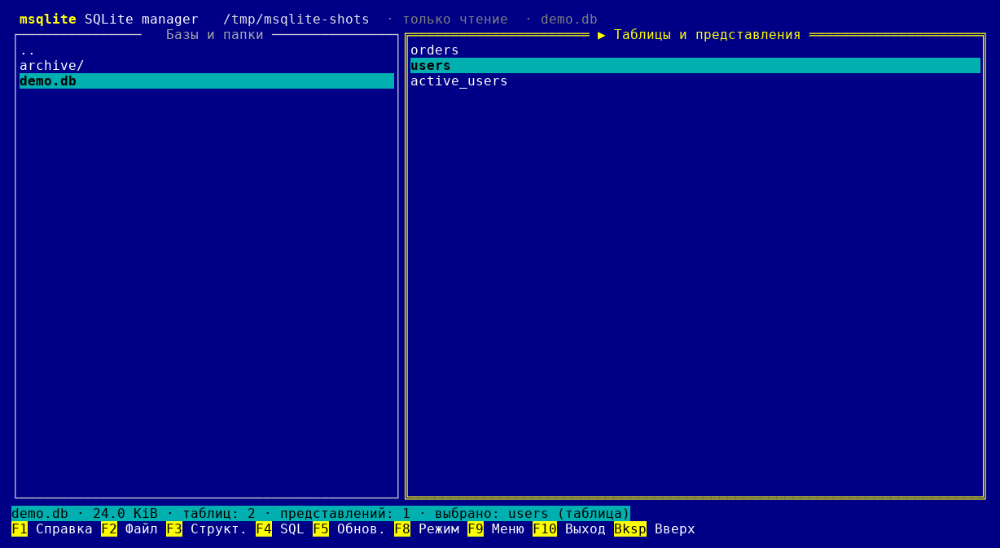
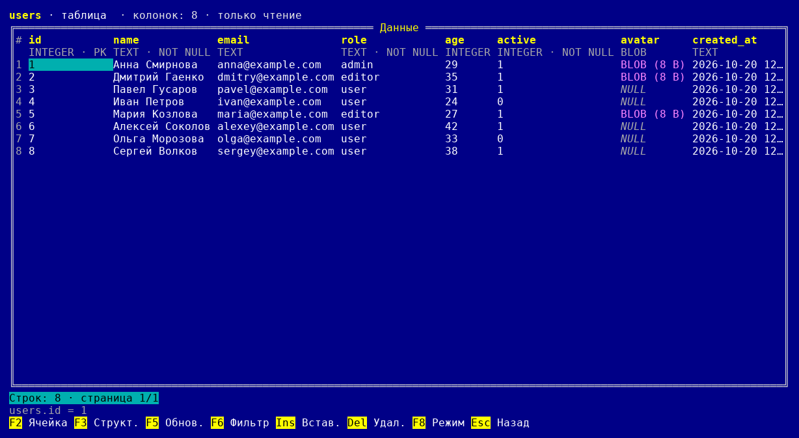
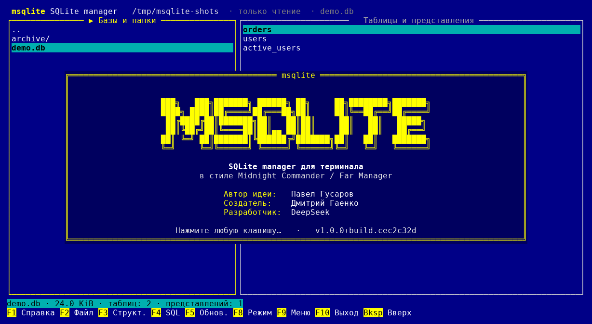

# msqlite

TUI-менеджер SQLite в стиле Midnight Commander / Far Manager. Позволяет
просматривать базы, таблицы, представления, структуру и данные, редактировать
записи и выполнять SQL-запросы прямо в терминале.

Работает на Linux, в том числе на Raspberry Pi 4B (Ubuntu / Raspberry Pi OS).
Бинарники статические, без внешних зависимостей.

## Возможности

- Файловый браузер: папки и SQLite-файлы в текущем каталоге, вход в подпапки,
  подъём через `..` или `Backspace` вплоть до `/`.
- Открытие базы аргументом (`msqlite file.db`) и список недавних баз.
- Список таблиц и представлений выбранной базы с числом строк (оценка `~N` из
  `sqlite_stat1`, для таблиц без статистики — точный `COUNT(*)`) и фильтром по
  имени (`/`).
- Структура объекта: колонки, типы, `NOT NULL`, значения по умолчанию,
  первичные ключи, индексы, внешние ключи, триггеры и DDL; generated-колонки
  помечаются и доступны только для чтения.
- Просмотр данных с постраничной навигацией, сортировкой, SQL-фильтром
  и отключаемыми вертикальными разделителями колонок.
- Автообновление открытой базы при изменении файла извне: список таблиц,
  данные и структура перечитываются с сохранением курсора и страницы.
- Редактирование ячеек, вставка и удаление строк (для обычных rowid-таблиц).
- Многострочная SQL-консоль с сохраняемой историей запросов, автодополнением
  (`Tab`/`Ctrl+Space`), конструктором запросов (`F6`), табличным результатом
  и отменой долгого запроса по `Esc`.
- Верхнее меню действий (`F9`) и быстрая палитра (`Ctrl+P`).
- Три темы интерфейса: Midnight Commander, DOS Navigator (серая) и
  DOS Navigator Blue (синяя, как в классическом DN II, с диалогами в стиле
  DN II); переключение в разделе «Интерфейс».
- Экспорт таблицы, текущей страницы, выбранной строки или результата SQL
  в CSV/JSON;
  импорт CSV и JSON, экспорт SQL-дампа.
- Резервное копирование базы, `VACUUM`, `ANALYZE`, проверка целостности.
- Копирование ячеек и строк в буфер обмена, дублирование строк.
- Просмотр BLOB в hex и сохранение BLOB в файл.
- Создание таблиц визуальным конструктором (колонки: тип, `PK`,
  `NOT NULL`, `DEFAULT`) и представлений; создание/удаление индексов,
  очистка и удаление таблиц.
- Режим «только чтение» по умолчанию; переключение на запись через `F8`.
- Определение баз по заголовку SQLite, а не по расширению файла.
- Сплеш-экран с авторами при запуске (закрывается через 3 секунды или любой
  клавишей; отключается флагом `-no-splash` или в разделе «Интерфейс»).
- Мышь: выбор панели, строки, ячейки и кнопок в диалогах; в меню `F9`
  кликабельны разделы верхней строки и пункты подменю.

## Скриншоты

### Главный экран и данные

<p align="center">
  
  
</p>

### Структура и SQL-консоль

<p align="center">
  
  
</p>

### Верхнее меню и сплеш

<p align="center">
  
  
</p>

## Требования

- Linux (amd64, arm64 или armv7).
- Для сборки: Go 1.22.2+ и `make`.
- Терминал с UTF-8 (для рамок и кириллицы). Рекомендуется минимум 80x24.

## Сборка

```bash
make build    # локальный бинарник: bin/msqlite
make pi       # Raspberry Pi / Ubuntu arm64: bin/msqlite-linux-arm64
make pi32     # 32-битный ARMv7: bin/msqlite-linux-armv7
make publish  # amd64 + arm64 и публикация обновления
make dist     # обе ARM-сборки и публикация обновления
```

`make publish` и `make dist` после сборки обновляют пакет обновления
(доступ к нему настраивается отдельно).

Сборка выполняется с `CGO_ENABLED=0`, бинарники статические.

## Версионирование

Версия вычисляется автоматически при сборке и внедряется в бинарник
в формате semver 2.0.0:

- Точный Git-тег `vX.Y.Z` даёт `X.Y.Z`; коммиты после тега и незакоммиченные
  изменения добавляются как build-metadata: `X.Y.Z+git.N.gHASH`,
  `X.Y.Z+HASH.dirty` — строка всегда остаётся валидным semver.
- Без тегов используется базовая версия из `VERSION`:
  `X.Y.Z+git.N.gHASH`; незакоммиченные изменения добавляют `.dirty`.
- Без Git берётся `VERSION` и добавляется `+build.<hash>` — хэш всех `.go`,
  `go.mod` и `go.sum`. Любое изменение исходников меняет версию.
- Принудительно задать версию: `MSQLITE_VERSION=1.2.3 make build`
  (значение проверяется на соответствие semver).

```bash
make version              # показать вычисленную версию
./bin/msqlite -version    # версия, commit, дата сборки, версия Go
```

Базовая версия хранится в `VERSION`; меняйте её для релиза. Для Git-релиза
используйте тег `vX.Y.Z`. Версия отображается в сплеше, справке и `-version`.
Собирайте релизы через `make`, а не напрямую через `go build`, иначе версия
останется `1.0.0-dev`.

## Установка

```bash
sudo ./install.sh
```

Установщик определяет архитектуру, при необходимости пересобирает бинарник
(если исходники новее), копирует его в `$PREFIX/bin` (по умолчанию
`/usr/local/bin`), создаёт симлинк `msqlite` и проверяет результат: совпадение
файла, симлинк, SHA256 и версию для нативной архитектуры.

```text
/usr/local/bin/msqlite-linux-arm64
/usr/local/bin/msqlite -> msqlite-linux-arm64
```

Опции:

```bash
sudo ./install.sh --prefix /opt/msqlite
./install.sh --dest "$HOME/bin"
./install.sh --dest ./bin --arch arm64
./install.sh --no-build              # ставить готовый бинарник без пересборки
sudo ./install.sh --uninstall
```

Также доступны `make install` и `make uninstall`.

## Запуск

```bash
msqlite                 # последний каталог (при первом запуске — текущий)
msqlite file.db         # сразу открыть базу
msqlite /data/db        # сразу открыть каталог
msqlite -dir /data/db   # указать каталог
msqlite -rw             # сразу с правами записи
msqlite -page 50        # размер страницы данных (по умолчанию 100)
msqlite -no-splash      # не показывать сплэш при запуске
msqlite -version
```

При старте показываются папки и SQLite-файлы выбранного каталога.
Режим отображается в шапке.

## Клавиши

### Главный экран

| Клавиша | Действие |
|---|---|
| `Tab` / `Shift+Tab` | переключение панелей |
| `/` | фильтр списка таблиц по имени (пусто — сбросить) |
| `Enter` | открыть базу/таблицу, войти в папку или `..` |
| `Backspace` | подняться на каталог выше (до `/`) |
| `F1` | справка |
| `F2` | открыть файл или каталог по пути |
| `F3` | структура выбранной таблицы |
| `F4` | SQL-консоль |
| `F5` | обновить каталог, данные и оценки счётчиков |
| `F8` | переключить режим чтение / запись |
| `F9` | верхнее меню: Файл, База, Данные, SQL, Интерфейс, Справка |
| `Ctrl+P` | быстрая палитра действий |
| `F10`, `Alt+X` | выход (с подтверждением) |
| `Esc` | выход с подтверждением (на подэкранах — назад) |

### Просмотр данных

| Клавиша | Действие |
|---|---|
| стрелки | перемещение по ячейкам |
| `Enter`, `F2` | редактировать ячейку / показать значение |
| `Ctrl+S` | сохранить ячейку |
| `Ins` | вставить строку |
| `Del` | удалить строку (с подтверждением) |
| `F6` | фильтр: конструктор `WHERE` (колонка, оператор, значение) или ручной ввод; пусто сбрасывает фильтр |
| `Ctrl+R` | сбросить фильтр |
| `F7` / `PgUp` | предыдущая страница |
| `PgDn` | следующая страница |
| `Home` / `End` | первая / последняя страница |
| `s` / клик по заголовку | сортировка колонки: ASC → DESC → без сортировки |
| `F3` | структура таблицы |
| `F5` | перечитать данные |
| `Esc` | назад |

Редактор ячейки подстраивает размер под тип: числовые поля открываются в
компактном окне (сохранение по `Enter`), строковые — в большом, BLOB и прочие
типы — в максимальном (сохранение по `Ctrl+S`, `Tab` переключает на кнопки).
Для текстовых ячеек доступны кнопки генерации хешей: `MD5`, `SHA-1`, `SHA-256`,
`SHA-512` и `bcrypt`.

### Структура таблицы

| Клавиша | Действие |
|---|---|
| `F2` | редактировать структуру |
| `F5` | обновить |
| `F4` | SQL-консоль |
| `Esc` | назад |

В редакторе структуры (`F2`): переименование таблицы, добавление, переименование
и удаление колонок. Изменение типа/ограничений существующих колонок, индексы и
внешние ключи — через SQL-консоль.

### SQL-консоль

| Клавиша | Действие |
|---|---|
| `Enter` | выполнить запрос |
| `Alt+Enter` | новая строка в запросе |
| `Tab` | автодополнение слова; повтор — следующий вариант. Если дополнять нечего — фокус на результат |
| `Ctrl+Space` | то же автодополнение SQL-команд, таблиц и полей |
| `F6` | конструктор SELECT: таблица, колонки, `WHERE`, `ORDER BY`, `LIMIT` |
| `F2` | полное значение выбранной ячейки |
| `Alt+↑` / `Alt+↓` | история запросов (сохраняется между запусками) |
| `F8` | переключить режим чтение / запись |
| `F9` | верхнее меню действий |
| `Esc` | отменить выполняющийся запрос, иначе назад |

Выполняется одна инструкция за раз. Для `SELECT` выводится не более 1000
строк. В режиме только чтения изменяющие запросы завершаются ошибкой SQLite.

### Действия `F9` / `Ctrl+P`

`F9` открывает верхнее меню с подменю. Переключение разделов — `←`/`→`
(или `Tab`), выбор пункта — `↑`/`↓`, выполнение — `Enter`, закрытие — `Esc`.
Разделы: **Файл**, **База**, **Данные**, **SQL**, **Интерфейс**, **Справка**.
`Ctrl+P` открывает те же действия плоским списком.

- Открытие недавних баз (список хранится в конфигурации пользователя)
  и создание новой базы данных.
- «Интерфейс» — выбор темы Midnight Commander, DOS Navigator или
  DOS Navigator Blue и размера страницы данных. Текущая тема отмечена
  галочкой.
- «О программе» в разделе «Справка» — повторный показ сплеша.
- Экспорт текущей таблицы (все строки), страницы, выбранной строки или
  результата SQL в CSV/JSON.
- Импорт CSV (заголовок распознаётся автоматически) и JSON (массив объектов)
  в текущую таблицу.
- Точный пересчёт счётчиков строк (в списке показываются оценки `~N` из
  `sqlite_stat1` после `ANALYZE`; для таблиц без статистики число строк
  считается запросом `COUNT(*)`).
- Сброс активного фильтра таблицы.
- Конструктор `WHERE` для фильтра: выбор колонки, оператора и значения с ручной правкой выражения.
- Экспорт SQL-дампа базы, резервная копия через `VACUUM INTO`.
- `VACUUM`, `ANALYZE`, `PRAGMA integrity_check`.
- Дублирование строки, копирование ячейки/строки в буфер обмена.
- Просмотр BLOB в hex, сохранение BLOB в файл.
- Создание таблиц визуальным конструктором и представлений; создание и
  удаление индексов, очистка и удаление таблицы.
- Экспорт результата SQL-запроса (до 1000 показанных строк) в CSV/JSON.

### Диалоги

Во всех диалогах есть кнопки `OK` и `Отмена`.
`Enter` или `Space` активируют выбранную кнопку, `Tab` / стрелки переключают
кнопки, `Esc` закрывает диалог. Активная кнопка подсвечена жёлтым.
Результаты SQL-запроса показывают вертикальные разделители колонок;
они отключаются в `F9` → «Интерфейс» → «Разделители колонок».

### Настройки

Настройки интерфейса сохраняются автоматически в
`~/.config/msqlite/config.json`:

- тема (`mc`/`dos`/`dos-blue`);
- размер страницы данных;
- вертикальные разделители колонок таблицы;
- режим по умолчанию (только чтение / чтение-запись);
- запоминание последнего открытого каталога (можно отключить);
- показ сплэша при запуске;
- история SQL-запросов (до 200).

Тема, размер страницы, разделители колонок и запоминание последней папки
меняются в `F9` → «Интерфейс», режим — клавишей `F8`.
Флаги `-rw` и `-page` имеют приоритет над сохранёнными значениями при запуске.
Последний каталог восстанавливается, если не заданы `-dir` или путь в аргументе,
и включено запоминание последней папки.
Старый файл `~/.config/msqlite/theme` учитывается, пока не создан общий
`config.json`.

### Форма вставки

| Клавиша | Действие |
|---|---|
| `Tab` / `↑` / `↓` | переход между полями |
| `PgUp` / `PgDn` | прокрутка полей |
| `Enter` | следующее поле / вставка на последнем |
| `Ctrl+S` | вставить строку |
| `Esc` | отмена |

Пустое поле не передаётся в `INSERT` (используется значение по умолчанию).
Значение `NULL` вставляет SQL `NULL`, `''` — пустую строку, `x'ABCD'` — BLOB.

## Режимы чтения и записи

- По умолчанию база открывается только для чтения.
- `F8` переключает режим на лету: текущая база переоткрывается, режим
  обновляется во всех экранах. Для новых баз режим сохраняется.
- Флаг `-rw` включает режим записи при старте.
- В режиме записи включена проверка внешних ключей SQLite (`foreign_keys=ON`).
- Если файл или каталог недоступны для записи, переключение завершится ошибкой.

## Ограничения

- Инлайн-редактирование доступно только для обычных таблиц с `rowid`.
  Представления (`VIEW`), таблицы `WITHOUT ROWID` и виртуальные таблицы
  доступны только для чтения; для них используйте SQL-консоль.
- BLOB-ячейки в табличном просмотре не редактируются (показываются как
  `BLOB (N B)`).
- SQL-консоль выполняет одну инструкцию; результаты `SELECT` ограничены
  1000 строками (экспорт результата тоже ограничен этим набором).
  Долгий запрос можно отменить по `Esc`; остальные операции (экспорт,
  обслуживание) выполняются синхронно.
- Редактор структуры поддерживает переименование таблицы и колонок,
  добавление/удаление колонок; изменение типа/ограничений — через SQL-консоль,
  индексы создаются и удаляются из меню «Данные».
- Нет подсветки синтаксиса SQL, одновременной работы с несколькими базами
  и поддержки SQLCipher.
- Одновременная работа с базой из другого процесса может привести к блокировке;
  в приложении используется таймаут ожидания.

## Структура проекта

```text
main.go                      точка входа, флаги командной строки
internal/db/db.go            доступ к SQLite, схема, данные, изменения
internal/db/export.go        экспорт CSV/JSON, SQL-дамп, импорт, backup
internal/db/db_test.go       тесты слоя БД
internal/ui/app.go           приложение, панели, страницы, горячие клавиши
internal/ui/browser.go       файловый браузер (папки, базы, подъём)
internal/ui/navigation.go    стек страниц и фокус экранов
internal/ui/appearance.go    темы, размер страницы, разделители, сплэш
internal/ui/datapage.go      табличный просмотр и редактирование
internal/ui/watcher.go       отслеживание изменений файла открытой базы
internal/ui/filter.go        конструктор WHERE для фильтра таблицы
internal/ui/actions.go       Ctrl+P меню, обслуживание, BLOB, буфер обмена
internal/ui/transfer.go      экспорт/импорт CSV и JSON
internal/ui/indexes.go       создание и удаление индексов
internal/ui/recent.go        список недавних баз
internal/ui/settings.go      сохранение настроек (config.json)
internal/ui/fileutil.go      атомарная запись файлов
internal/ui/edit.go          редактор ячейки
internal/ui/insert.go        форма вставки строки
internal/ui/structurepage.go структура таблицы (колонки, индексы, FK, триггеры)
internal/ui/sqlpage.go       SQL-консоль
internal/ui/dialogs.go       модальные окна и ввод
internal/ui/help.go          справка
internal/ui/splash.go        стартовый экран
internal/ui/theme.go         цвета и стили
internal/ui/helpers_test.go  тесты чистых UI-хелперов
scripts/version.sh           вычисление версии (Git или хэш исходников)
VERSION                      базовая версия
install.sh                   установщик с автоопределением платформы
Makefile                     сборка, версия и установка
```

## Разработка

```bash
go test ./...
go test -race ./...
go vet ./...
```

## Авторы

- Автор идеи: Павел Гусаров
- Создатель: Дмитрий Гаенко
- Разработчик: DeepSeek

Базовая версия: 1.0.0 (автоматическая — см. `msqlite -version`)
